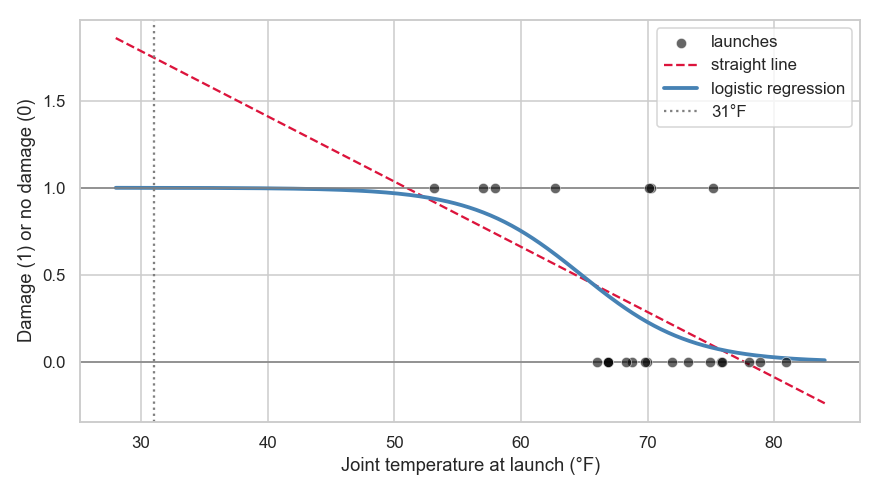
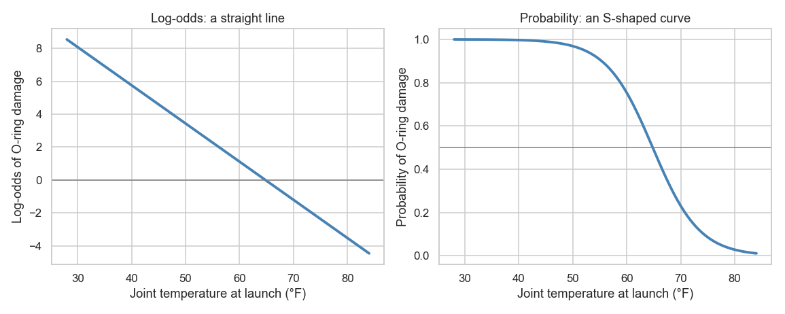
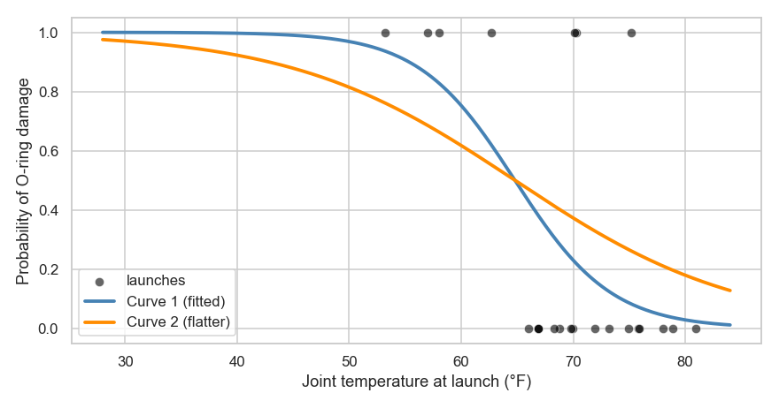

# Logistic Regression in Plain Language

This is the first of two readings that replace [18_2_0_1](18_2_0_1_LogReg_Basics.md). It introduces the main ideas of logistic regression, and it starts each one with a situation in which somebody needed an answer and brings in the formula afterward. Each section begins with a StatQuest video. Watch the video first, then read the section, which explains the same ideas again with a different example.

Two real cases come up throughout. One is the decision to launch the space shuttle Challenger. The other is a medical study whose main finding was widely misreported because odds were read as probabilities.

---

## 1. When the answer is yes or no

**Watch first:** [StatQuest: Logistic Regression](https://www.youtube.com/watch?v=yIYKR4sgzI8)

On the night before January 28, 1986, engineers and managers held a phone conference about whether the space shuttle Challenger should launch in the morning. The forecasts were for temperatures below freezing at launch time, much colder than at any earlier launch. Different forecast figures appear in the records. We will use 31°F, the one used in statistical analyses of these data. Some of the engineers were worried about the O-rings, the rubber seals in the joints of the booster rockets. Rubber gets stiff when it is cold, and a stiff seal may not seal. The shuttle launched anyway. An O-ring failed, the shuttle broke apart 73 seconds into the flight, and all seven people on board died.

There were data available that night. The shuttle program had records for 23 earlier launches: the estimated temperature of the booster joints at launch, and whether any of the O-rings in the field joints had been damaged. The field joints connect the main sections of each booster, and the joint that failed on Challenger was one of them. Seven of the 23 launches had some damage there. From here on, "damage" means field-joint damage. The boosters also have nozzle joints, and some of the launches counted as having no damage did have damage there.

Suppose you had been handed those 23 records and asked, "What is the chance of O-ring damage tomorrow?" You already know how to draw a line through data, so you might start there. Code damage as 1 and no damage as 0, and fit a linear regression with temperature as the feature.

The straight line has one thing right, which is that damage becomes less likely as it gets warmer. But follow it to the ends. At 31°F it predicts 1.75, and at 81°F it predicts −0.12. If these are supposed to be probabilities, the line is claiming a 175% chance of damage on a cold day and a −12% chance on a warm one. The line does not know that a probability has to stop at 0 and at 1.

The S-shaped curve is what logistic regression fits. It goes down as the temperature goes up, as the line does, but it flattens out near 0 and near 1 instead of passing through them. This is the same curve as the one for the mice in the video, except that it runs in the other direction: heavier mice are more likely to be obese, and warmer launches are less likely to have damage.

We read the curve as a probability. At 53°F, the coldest of the 23 launches, it gives 0.94. At 75°F it gives 0.09. If we have to answer yes or no, we pick a threshold, such as 0.5, and say yes at or above it. The curve crosses 0.5 at about 65°F. You saw in 18_1 that 0.5 is only a default, and this is a case where you would think hard about it: failing to predict damage that does happen is much worse than delaying a launch that would have been fine.

Deciding which launches to look at also matters. In the discussion before the launch, the comparison of past flights focused on ones that *had* damage, and left out the flights without any. The seven launches with damage happened at 53, 57, 58, 63, 70, 70 and 75 degrees, and by themselves they do not show an obvious pattern. The 16 launches without damage were all at 66°F or above, so all four launches below 65°F had damage, compared with 3 of the 19 launches at 65°F or above. To learn what separates the yeses from the noes, a model needs examples of both.

---

## 2. Odds and log-odds: another way to say how likely something is

**Watch first:** [Odds and Log(Odds), Clearly Explained!!!](https://www.youtube.com/watch?v=ARfXDSkQf1Y)

We need a way to get from a straight line, which can produce any number, to a probability, which cannot. The way to do this involves a different measure of how likely something is. You already know it if you have ever heard someone talk about a bet.

Consider a basketball player who makes 80% of her free throws. There are two ways to describe her:

- **Probability** compares the makes with *all* of the shots: 80 makes out of 100 shots, or 0.80.
- **Odds** compare the makes with the *misses*: 80 makes to 20 misses, or 4 to 1. As a single number, the odds are 80 / 20 = 4.

These are the same facts about the same player, with a different number on the bottom of the fraction. With a probability $p$, the makes are $p$ and the misses are $1 - p$, so

$$\text{odds} = \frac{p}{1 - p} = \frac{0.80}{0.20} = 4$$

To go back, add the two sides together to recover the total. Odds of 4 mean 4 makes for every 1 miss, which is 4 makes out of 5 shots:

$$p = \frac{\text{odds}}{1 + \text{odds}} = \frac{4}{1 + 4} = 0.80$$

Odds are not limited to the range from 0 to 1. A player who makes 99 out of 100 has odds of 99. This solves half of our problem, because odds have no upper limit. They still cannot go below 0, though, and they are lopsided. Compare a player who makes 80% with a player who makes 20%. Those two are equally far from being a 50/50 shooter, but their odds are 4 and 0.25. All of the shooters below 50% have odds between 0 and 1, while the shooters above 50% are spread out from 1 upward.

Taking the natural logarithm of the odds fixes the lopsidedness. The logarithm of 4 is 1.39, and the logarithm of 0.25 is −1.39. Now the two players are the same distance from 0 in opposite directions, and 0 means 50/50.

| Makes | Probability | Odds | Log-odds |
|---|---|---|---|
| 1 in 100 | 0.01 | 0.01 | −4.60 |
| 20 in 100 | 0.20 | 0.25 | −1.39 |
| 50 in 100 | 0.50 | 1 | 0 |
| 80 in 100 | 0.80 | 4 | 1.39 |
| 99 in 100 | 0.99 | 99 | 4.60 |

The last column can be any number at all, negative or positive, which is also true of a straight line. So the idea behind logistic regression is to **draw a straight line for the log-odds, and then convert the log-odds back into a probability.**

The log-odds also capture something we know from experience about improvement. Suppose one player goes from making 50% to making 59%, and another goes from 90% to 99%. Both improved by 9 percentage points, but anyone who has played would say that the second improvement is harder to achieve. The 90% player had to get rid of nine out of every ten misses. In log-odds, the first player moved from 0 to 0.36, and the second moved from 2.20 to 4.60. Near the ends of the scale it takes a large change in log-odds to move the probability by a small amount, which is why the S-shaped curve is flat at the ends and steep in the middle.

To convert log-odds $z$ to a probability, first undo the logarithm to get the odds, $e^z$, and then use the odds-to-probability formula:

$$p = \frac{e^z}{1 + e^z} = \frac{1}{1 + e^{-z}}$$

The two versions are the same formula (divide the top and bottom of the first by $e^z$ to get the second). This is the **sigmoid**, or logistic function, that gives logistic regression its name. For the 80% shooter, $z = 1.39$ and $e^{-1.39} = 0.25$, so $p = 1 / 1.25 = 0.80$.

---

## 3. Odds ratios, and how a 91% to 85% difference became "40% less likely"

**Watch first:** [Odds Ratios and Log(Odds Ratios), Clearly Explained!!!](https://www.youtube.com/watch?v=8nm0G-1uJzA) (You can stop at about 4:54, when the video begins to discuss statistical significance. The rest covers Fisher's exact test, the chi-squared test and the Wald test.)

In 1999 the *New England Journal of Medicine* published a study in which about 700 doctors watched videotaped interviews with actors playing patients who had chest pain. Each doctor watched one interview. The actors read from prepared scripts, and the patients they played differed in race, sex and age. The doctors were asked whether they would refer the patient they saw for a heart test called cardiac catheterization.

The study reported that Black patients were referred less often than white patients, with an **odds ratio** of 0.6. News coverage, and many people who read it, took this to mean that Black patients were 40% less likely to be referred. Later that year the same journal published an analysis titled "Misunderstandings about the Effects of Race and Sex on Physicians' Referrals for Cardiac Catheterization." Its authors pointed out that the referral rates were about 91% for white patients and 85% for Black patients. (The same 91% and 85% applied to men and women. When the groups were separated further, the gap came mostly from Black women, who were referred about 79% of the time, compared with 91% for each of the other three groups.)

The difference was real and worth taking seriously, but 85% is not 40% less than 91%. To see what happened, work through both calculations.

**Comparing probabilities:** 0.85 / 0.91 = 0.93. Black patients were about 0.93 times as likely to be referred, which is about 7% less likely.

**Comparing odds:**

- White patients: 0.91 / 0.09 = 10.1
- Black patients: 0.85 / 0.15 = 5.7
- Odds ratio: 5.7 / 10.1 = 0.56 (with the less rounded rates of 90.6% and 84.7% it is 0.57, and the study's table shows 0.6)

An **odds ratio** is one group's odds divided by another group's odds. The calculation above is correct, and an odds ratio of 0.56 really does mean that the odds were 44% lower. The trouble came from describing it with the word "likely," which readers understand as a statement about probability.

Why are the two comparisons so far apart? When most patients are referred, the odds depend heavily on the small number who are not. Going from 91% to 85% means that the share of patients *not* referred went from 9% to 15%. That increase in the bottom of the fraction cuts the odds almost in half, even though the share referred changed by only 6 percentage points.

When an event is rare, the two comparisons nearly agree. If one group has a 1% chance and another has a 2% chance, the second is 2 times as likely, and the odds ratio is (0.02 / 0.98) / (0.01 / 0.99) = 2.02. So reading an odds ratio as if it were about probability is nearly harmless for rare events, and can be badly wrong for common ones.

You can use these rules to read an odds ratio:

- An odds ratio of 1 means that the two groups have the same odds.
- Above 1, the odds are higher. An odds ratio of 1.4 means 40% higher odds.
- Below 1, the odds are lower. An odds ratio of 0.56 means 44% lower odds.

The logarithm helps here too. The odds ratio of 0.56 compares Black patients with white patients. If we reverse the comparison, the odds ratio is 10.1 / 5.7, or about 1.8. Their logs are −0.58 and 0.58, so the size of the difference is the same whichever group comes first.

---

## 4. Coefficients: what the model is telling you

**Watch first:** [Logistic Regression Details Pt1: Coefficients](https://www.youtube.com/watch?v=vN5cNN2-HWE) (Skip over the standard errors, z values and p-values for now. They come back in 18_2_2.)

Now we can put the pieces together on the Challenger data. The model draws a straight line for the log-odds of O-ring damage, and fitting it to the 23 launches gives

$$z = 15.043 - 0.2322 \times \text{temperature}$$

The two panels below show the same model. On the left the vertical axis is log-odds, and the model is a straight line. On the right every point on that line has been sent through the sigmoid, and the model is the S-shaped curve from Section 1. This is what people mean when they call logistic regression a linear model: it is linear in the log-odds, and not in the probability.

**Making a prediction.** For the launch at 53°F:

1. Find the log-odds: $z = 15.043 - 0.2322 \times 53 = 2.736$
2. Use the sigmoid: $p = 1 / (1 + e^{-2.736}) = 1 / (1 + 0.065) = 0.94$

**Reading the coefficient.** The coefficient −0.2322 means that each additional degree lowers the log-odds of damage by 0.2322. Most people have no feeling for what 0.2322 log-odds is, so we turn it into an odds ratio by raising $e$ to that power: $e^{-0.2322} = 0.793$. Each additional degree multiplies the odds of damage by 0.793, which means that the odds are about 21% lower.

This works because of how exponents behave. Adding to the log-odds is the same as multiplying the odds: $e^{z + b} = e^z \times e^b$. Adding −0.2322 ten times, for a change of ten degrees, multiplies the odds by $e^{-2.322} = 0.098$, so a launch that is ten degrees warmer has about one tenth of the odds of damage.

**The odds change steadily, and the probability does not.** Look at what two ten-degree changes do:

| Temperature | Odds of damage | Probability of damage |
|---|---|---|
| 60°F | 3.04 | 0.75 |
| 70°F | 0.30 | 0.23 |
| 80°F | 0.03 | 0.03 |

Each step of ten degrees multiplies the odds by about 0.098. But the probability falls by 52 percentage points in the first step and by 20 in the second. The first step crosses the steep middle of the curve, and the second takes place mostly along the flat bottom. If somebody asks how much ten degrees changes the chance of damage, the correct answer depends on the temperature you start from.

**When the feature is a category.** The second half of the video uses a feature that is either 0 or 1, such as a normal gene or a mutated gene. The referral study works the same way. Code white patients as 0 and Black patients as 1, and leave out everything else:

- The intercept is the log-odds for the group coded 0: $\ln(0.91/0.09) = \ln(10.11) = 2.314$
- The coefficient is the log of the odds ratio: $\ln(0.56) = -0.579$ (using the unrounded 0.5604)

For a Black patient, $z = 2.314 - 0.579 = 1.735$, and the sigmoid gives 0.85, the rate that we started with. The group coded 0 is the **reference group**, as with the dummy columns in module 17.

**Holding other things equal.** With several features, the model adds up one term for each of them: $z = \beta_0 + \beta_1 x_1 + \beta_2 x_2 + \dots$. Each coefficient then describes a one-unit change in its feature while the others stay the same, just as it did in multiple regression.

**What about 31 degrees?** The model gives $z = 15.043 - 0.2322 \times 31 = 7.845$, for a probability of 0.9996. Be careful with that number. The coldest of the 23 launches was at 53°F, so the model has no data within 20 degrees of 31, and 23 launches are not many. What the data do support is that colder launches had much higher odds of damage and that the planned launch was far colder than any of them. This is also a model of *damage* to a field-joint O-ring, and all seven of the earlier launches with that damage returned safely, so 0.9996 is not the probability of an accident.

---

## 5. Maximum likelihood: choosing the curve that makes the data least surprising

**Watch first:** [Logistic Regression Details Pt 2: Maximum Likelihood](https://www.youtube.com/watch?v=BfKanl1aSG0)

Where did 15.043 and −0.2322 come from? In linear regression the answer was least squares: choose the line with the smallest squared residuals. The video explains why that does not work here. On the log-odds scale, a launch that had damage has a probability of 1, and its log-odds are infinite. The distance from the line to a point at infinity is infinite for every line, so it cannot help us choose.

Instead, imagine two weather forecasters. Over the same three days, it rained on the first day and stayed dry on the other two. Before each day, the first forecaster gave a 94% chance of rain, then 37%, then 4%. The second gave 76%, then 45%, then 20%. Neither was certain of anything, but you would trust the first one more, because what actually happened was closer to what that forecaster said to expect.

Maximum likelihood judges a candidate curve the way you judged the forecasters. For each observation, it asks what probability the curve gave to *what actually happened*. If damage happened, that is $p$. If it did not, that is $1 - p$. The probabilities for all of the observations are multiplied together, and the result is the **likelihood** of the data for that curve.

Here are two candidate curves and three of the launches. Curve 1 is the fitted model. Curve 2 also crosses 0.5 at about 65°F, but it is flatter (its coefficient is −0.10).

| Launch | What happened | Curve 1 says | Probability of what happened | Curve 2 says | Probability of what happened |
|---|---|---|---|---|---|
| 53°F | damage | 0.939 | 0.939 | 0.765 | 0.765 |
| 67°F | no damage | 0.375 | 1 − 0.375 = 0.625 | 0.445 | 1 − 0.445 = 0.555 |
| 79°F | no damage | 0.036 | 1 − 0.036 = 0.964 | 0.195 | 1 − 0.195 = 0.805 |

- Curve 1: 0.939 × 0.625 × 0.964 = 0.566
- Curve 2: 0.765 × 0.555 × 0.805 = 0.342

On these three launches, Curve 1 has the larger likelihood. What happened is less surprising if Curve 1 is right. **Maximum likelihood estimation** does this with all of the observations and chooses the coefficients for which the likelihood is as large as possible.

**Why take the log?** Multiplying many numbers below 1 gives a very small number. For all 23 launches, the likelihood of Curve 1 is about 0.00004, and with thousands of observations the product would be too small for a computer to store. The logarithm turns multiplication into addition, and it does not change which curve is best. For the three launches, the log-likelihood of Curve 1 is −0.063 − 0.470 − 0.037 = −0.570, and for Curve 2 it is −1.073 (the log of 0.342). The larger number, the one closer to 0, is better. For all 23 launches, Curve 1 has −10.16 and Curve 2 has −11.62, so Curve 1 is still preferred.

You have already met this quantity. Flip the sign of the log-likelihood and divide by the number of observations, and you have **log loss**, the `logloss` setting from the XGBoost notebooks in 18_1. Making the likelihood as large as possible is the same as making the log loss as small as possible. Curve 1's log loss is 10.16 / 23 = 0.442, and Curve 2's is 11.62 / 23 = 0.505.

---

## 6. Gradient descent: finding the best curve without trying them all (optional)

**Watch first:** [Gradient Descent, Step-by-Step](https://www.youtube.com/watch?v=sDv4f4s2SB8) (The video uses linear regression and works out derivatives. If you have not had calculus, follow the pictures. The idea carries over to logistic regression.)

Linear regression has a formula that gives the best coefficients directly. Logistic regression does not, so the computer has to search. It starts with a guess, improves it, and repeats.

Think about adjusting a shower in an unfamiliar bathroom. You do not try every position of the handle. You feel the water, decide which way to turn the handle, and turn it. If the water is far too cold you make a large turn, and as it gets close to comfortable your turns get smaller. You stop when another small turn would make no difference.

Gradient descent works in the same way, with log loss in place of the water temperature. Here is the log loss on the 23 launches for several values of the temperature coefficient. (To keep the example to one number, the intercept is adjusted each time so that the curve still crosses 0.5 at the same temperature.)

| Coefficient | Log loss |
|---|---|
| −0.05 | 0.579 |
| −0.10 | 0.505 |
| −0.15 | 0.463 |
| −0.20 | 0.445 |
| −0.232 | 0.442 |
| −0.30 | 0.452 |
| −0.40 | 0.492 |

Suppose we start at −0.05. Moving to −0.10 lowers the log loss by 0.074, so that is the right direction, and the loss is falling quickly. Moving from −0.15 to −0.20 lowers it by only 0.018, which tells us that we are getting close. Going beyond −0.232 makes the log loss rise again, so the best value is near there.

- The **gradient** tells the computer which direction lowers the loss and how steeply the loss is changing.
- The **learning rate** sets how big a step to take for a given gradient. If it is too large, the search can jump past the best value, like turning the handle from too cold to scalding. If it is too small, the search takes a very long time.
- The search has **converged** when the steps have become so small that the coefficients are hardly changing.

Scikit-learn's default method for logistic regression (L-BFGS) is a relative of gradient descent that chooses its steps more cleverly. Plain gradient descent comes back in 18_2_3, because it is the starting point for how neural networks are trained.

---

## Looking back

- Logistic regression predicts the probability of a yes. A straight line will not work, because it goes below 0 and above 1.
- Odds compare yes with no. Log-odds are the natural log of the odds, and they can be any number, so the model uses a straight line for the log-odds.
- The sigmoid converts the log-odds back to a probability.
- A coefficient is a change in log-odds for a one-unit change in a feature. Raising $e$ to the coefficient gives an odds ratio, which multiplies the odds and does not multiply the probability.
- The same odds ratio can change the probability by a lot or by a little, depending on the starting point.
- The coefficients are chosen so that the model gives as much probability as possible to what actually happened.

**What's next:** [18_2_0_3](18_2_0_3_LogReg_Math.md) goes back over the same ideas and shows where the formulas come from: why the log-odds line and the S-shaped curve are the same model, why $e$ raised to a coefficient is the same odds ratio for everybody, and how the computer finds the coefficients. After that, [18_2_1](18_2_1_LogReg_Intro_w_Titanic.ipynb) fits a model with seven features.

---

## Sources

- The O-ring data are the 23 launches before Challenger analyzed in Dalal, Fowlkes and Hoadley, "Risk Analysis of the Space Shuttle: Pre-Challenger Prediction of Failure," *Journal of the American Statistical Association* 84 (1989), 945–957. Here an outcome of 1 means that at least one field-joint O-ring showed erosion or blow-by (hot gas leaking past the seal). Damage in the nozzle joints is not counted. Temperatures are estimated joint temperatures. The measured air temperature when Challenger was launched was 36°F, and testimony to the Rogers Commission mentions a forecast of about 26°F.
- Schulman and colleagues, "The Effect of Race and Sex on Physicians' Recommendations for Cardiac Catheterization," *New England Journal of Medicine* 340 (1999), 618–626.
- Schwartz, Woloshin and Welch, "Misunderstandings about the Effects of Race and Sex on Physicians' Referrals for Cardiac Catheterization," *New England Journal of Medicine* 341 (1999), 279–283. The calculations in Sections 3 and 4 use the rounded rates of 91% and 85%.
- The free-throw numbers and the weather forecasts are made up for illustration.
