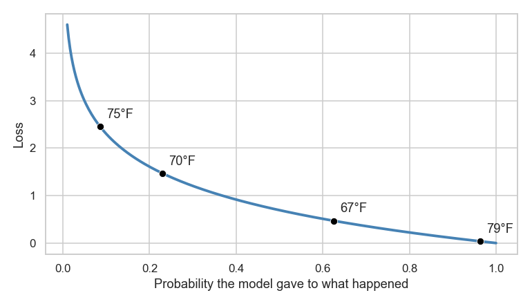
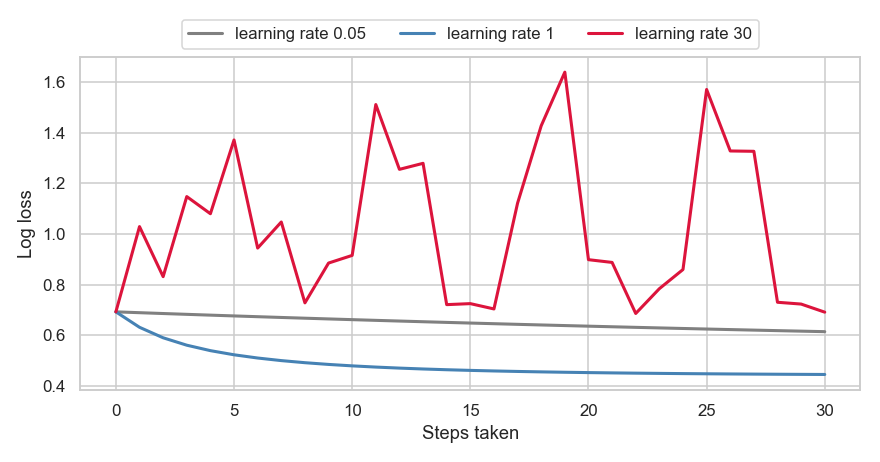

# The Math Behind Logistic Regression

[18_2_0_2](18_2_0_2_LogReg_Plain_Language.md) explained what logistic regression does, and it asked you to accept several things without seeing where they come from. This reading fills in those steps:

- Why do the log-odds and the S-shaped curve describe the same model?
- Why does raising $e$ to a coefficient give an odds ratio, and why is it the same for everybody?
- How do you write down "the probability of what happened" as one formula, and what does that have to do with log loss?
- How does the computer find the best coefficients?

Every formula is worked out with numbers from the Challenger data in 18_2_0_2: 23 launches, 7 with O-ring damage, and one feature, the launch temperature. The fitted model is

$$z = 15.043 - 0.2322 \times \text{temperature}$$

As before, each section begins with a StatQuest video. You need algebra for Sections 1 to 5. Section 6 uses the idea of a slope, and any calculus in it is optional. The numbers were computed before rounding, so your own arithmetic may differ in the last digit.

---

## 1. Four rules about logs and exponents

**Watch first:** [Logs (logarithms), Clearly Explained!!!](https://www.youtube.com/watch?v=VSi0Z04fWj0)

The video says that a log isolates an exponent. The log base 2 of 8 is 3, because 8 is 2 to the power 3. In this module the base is $e \approx 2.718$ instead of 2, and the log is called the **natural log**, written $\ln$. The natural log of 8 is 2.079, because $e^{2.079} = 8$.

Think of money in an account that doubles, and then triples. To find the total growth you multiply: 2 × 3 = 6 times as much. If you keep your records in logs, you add instead: $\ln 2 + \ln 3 = 0.693 + 1.099 = 1.792$, and $e^{1.792} = 6$. Logistic regression moves back and forth between these two ways of keeping records. The model adds in logs, and the odds multiply.

| Rule | Example |
|---|---|
| $\ln$ and $e$ undo each other: $e^{\ln a} = a$ and $\ln(e^a) = a$ | $\ln 4 = 1.386$ and $e^{1.386} = 4$ |
| Adding exponents multiplies: $e^{a+b} = e^a \times e^b$ | $e^{0.693 + 1.099} = 2 \times 3 = 6$ |
| The log of a product is a sum: $\ln(ab) = \ln a + \ln b$ | $\ln 6 = 0.693 + 1.099$ |
| The log of a ratio is a difference: $\ln(a/b) = \ln a - \ln b$ | $\ln(3/2) = 1.099 - 0.693 = 0.405$ |

Two values are worth remembering: $e^0 = 1$, so $\ln 1 = 0$. Also, $e^{-a} = 1 / e^{a}$, so a negative exponent gives a number between 0 and 1. There is no log of 0 or of a negative number.

---

## 2. From log-odds to the S-shaped curve

**Watch first:** [Logistic Regression Details Pt1: Coefficients](https://www.youtube.com/watch?v=vN5cNN2-HWE), up to the point where the straight line on the log-odds scale is explained. (You can skip the standard errors and p-values.)

The model begins with a straight line for the log-odds:

$$\ln\left(\frac{p}{1-p}\right) = z, \qquad z = \beta_0 + \beta_1 x_1 + \beta_2 x_2 + \dots + \beta_k x_k$$

The left side is called the **logit** of $p$. It is the log of the odds, and the odds are the only place where $p$ appears. What we want in the end is $p$, so we have to solve for it. Each step below undoes one thing that was done to $p$.

1. Undo the log by raising $e$ to both sides: $\dfrac{p}{1-p} = e^z$
2. Multiply both sides by $1 - p$: $p = e^z (1 - p) = e^z - e^z p$
3. Bring the $p$ terms together: $p + e^z p = e^z$
4. Factor out $p$: $p(1 + e^z) = e^z$
5. Divide: $p = \dfrac{e^z}{1 + e^z}$

Dividing the top and bottom by $e^z$ gives the form that is usually printed:

$$p = \frac{1}{1 + e^{-z}}$$

This is the **sigmoid** function. So the sigmoid is not a separate assumption. If the log-odds are a straight line, the probability must be this curve.

Step 5 is also a formula you know. Since $e^z$ is the odds, it says $p = \text{odds} / (1 + \text{odds})$.

**Check that it behaves like a probability.** Because $e^{-z}$ is always positive, the bottom of the fraction is always more than 1, so $p$ is always below 1. It is also always above 0. Here are three values:

| $z$ | $e^{-z}$ | $p = 1/(1 + e^{-z})$ |
|---|---|---|
| −3 | 20.09 | 0.047 |
| 0 | 1 | 0.5 |
| 3 | 0.050 | 0.953 |

The values for $z = -3$ and $z = 3$ add up to 1. This is true of any $z$ and its negative, so the curve has the same shape on both sides of 0.5.

**A threshold on $p$ is a threshold on $z$.** The sigmoid always goes up as $z$ goes up, so "$p$ is at least $t$" is the same as "$z$ is at least $\ln(t/(1-t))$." For a threshold of 0.5, that is $z \ge \ln 1 = 0$. The Challenger model has $z = 0$ where $15.043 = 0.2322 \times \text{temperature}$, at 64.8°F, and it predicts damage below that temperature. If we wanted to be more careful and used a threshold of 0.2, the cutoff would be $\ln(0.2/0.8) = -1.386$. Solving $15.043 - 0.2322 \times \text{temperature} = -1.386$ gives 70.8°F. Lowering the threshold moves the cutoff temperature, and the coefficients stay as they were.

With two features, the values where $z = 0$ form a straight line in the plane of the two features. With more features they form a flat surface. That set of values is the **decision boundary**, and it is another sense in which the model is linear.

---

## 3. Why $e^\beta$ is an odds ratio, and why it is the same for everybody

**Watch first:** [Odds Ratios and Log(Odds Ratios), Clearly Explained!!!](https://www.youtube.com/watch?v=8nm0G-1uJzA), up to the discussion of statistical significance.

In 18_2_0_2 each additional degree multiplied the odds of damage by 0.793. Why does it not matter which degree we add? Going from 60 to 61 has the same odds ratio as going from 80 to 81, even though the probabilities involved are completely different.

Start with the model on the odds scale. Raising $e$ to both sides of the log-odds equation, and using the rule that adding exponents multiplies, gives

$$\text{odds} = e^{\beta_0 + \beta_1 x_1 + \beta_2 x_2} = e^{\beta_0} \times e^{\beta_1 x_1} \times e^{\beta_2 x_2}$$

Each feature supplies one factor. Now raise $x_1$ by 1 and keep $x_2$ the same, and divide the new odds by the old odds:

$$\frac{e^{\beta_0} \times e^{\beta_1 (x_1 + 1)} \times e^{\beta_2 x_2}}{e^{\beta_0} \times e^{\beta_1 x_1} \times e^{\beta_2 x_2}} = \frac{e^{\beta_1 (x_1 + 1)}}{e^{\beta_1 x_1}} = e^{\beta_1}$$

The factors for the intercept and for the other feature cancel, and so does the starting value $x_1$. This cancellation is the whole reason the odds ratio is the same for everybody. It also shows what "all else equal" is doing: if $x_2$ had changed too, its factor would not have cancelled.

**Changes other than one unit.** The same algebra with a change of $c$ units gives $e^{c\beta_1}$. Ten degrees give $e^{10 \times (-0.2322)} = 0.098$. If a feature was standardized, one unit is one standard deviation, so a change of $k$ original units is $k / \text{SD}$ standardized units, and the odds ratio is $e^{\beta k/\text{SD}}$.

**A coefficient of 0** gives $e^0 = 1$. The odds are multiplied by 1, which means that the feature makes no difference in the model.

**What the intercept means.** If every feature is 0, then $z = \beta_0$ and the odds are $e^{\beta_0}$. In the Challenger model this would be the odds of damage at 0°F, which is far outside the data, so the number by itself is not useful. If we measure temperature as $x = (\text{temperature} - 70)/10$ instead, the same model becomes

$$z = -1.208 - 2.322\,x$$

Now the intercept is the log-odds at 70°F, and $1/(1 + e^{1.208}) = 0.23$, which matches the probability for 70°F in 18_2_0_2. The coefficient is ten times as large because one unit of $x$ is ten degrees. The predictions did not change at all. When you see a surprising intercept or a coefficient that looks large, check what one unit and zero mean.

**What happens to the probability.** The change in probability is not constant, but there is a helpful limit on it. The slope of the probability curve at any point is $\beta \times p \times (1 - p)$. The product $p(1-p)$ is largest when $p = 0.5$, where it is 0.25, so the steepest slope is $\beta / 4$. For the Challenger model that is $-0.2322 / 4 = -0.058$, or about 6 percentage points per degree.

| Change | Probability before | Probability after | Difference |
|---|---|---|---|
| 64°F to 65°F | 0.546 | 0.488 | −0.058 |
| 79°F to 80°F | 0.036 | 0.028 | −0.007 |

Near 0.5 the change is as large as the limit, and out on the flat part of the curve it is about one eighth of that. The odds ratio is 0.793 in both rows. Dividing a coefficient by 4 is a quick way to find out how much one unit could change the probability at most.

---

## 4. Likelihood: one formula for "the probability of what happened"

**Watch first:** [In Statistics, Probability is not Likelihood.](https://www.youtube.com/watch?v=pYxNSUDSFH4) and then [Logistic Regression Details Pt 2: Maximum Likelihood](https://www.youtube.com/watch?v=BfKanl1aSG0)

In everyday speech, probability and likelihood mean the same thing. In statistics they ask about different unknowns. Suppose that a coin may or may not be fair.

- **Probability:** the coin is known to be fair, and we ask about results we have not seen yet. What is the probability of 8 heads in 10 tosses?
- **Likelihood:** we have already seen 8 heads in 10 tosses, and we ask about the coin. How well does "this coin is fair" account for what we saw, compared with "this coin lands heads 80% of the time"?

When a model is fitted, the data have already happened and do not change. The coefficients are what we are asking about. That is why the quantity is called a likelihood.

**One observation.** Let $y_i$ be 1 if launch $i$ had damage and 0 if it did not, and let $p_i$ be the model's probability of damage. The model's probability for what happened is $p_i$ when $y_i = 1$, and $1 - p_i$ when $y_i = 0$. Both cases can be written at once:

$$L_i = p_i^{\,y_i} \,(1 - p_i)^{\,1 - y_i}$$

This uses the fact that any positive number to the power 0 is 1. If $y_i = 1$, the second factor is raised to the power 0 and disappears, leaving $p_i$. If $y_i = 0$, the first factor disappears, leaving $1 - p_i$.

**All of the observations.** If the launches are independent, the probability of all of the outcomes together is the product:

$$L = L_1 \times L_2 \times \dots \times L_n$$

You multiply for the same reason that the probability of two heads in a row is 0.5 × 0.5.

**The log-likelihood.** Taking the log turns the product into a sum, and it brings the exponents down:

$$\ln L = \sum_{i=1}^{n} \Big[\, y_i \ln p_i + (1 - y_i) \ln(1 - p_i) \,\Big]$$

For each observation, one of the two terms is multiplied by 0. What remains is the log of the probability that the model gave to what happened. Because the log always increases when its input increases, the coefficients that make $L$ largest also make $\ln L$ largest. For the fitted Challenger model, $L$ is about 0.00004 and $\ln L$ is −10.16.

---

## 5. Log loss: how much each wrong prediction costs

**Watch first:** the second half of [Logistic Regression Details Pt 2: Maximum Likelihood](https://www.youtube.com/watch?v=BfKanl1aSG0) again, paying attention to the log-likelihoods of −3.77 and −4.15.

In regression, we could look at the squared residual for each house and see which houses the model got badly wrong. We can do the same thing here. For each launch, take the probability that the model gave to what happened, take its log, and flip the sign. The result is that launch's **loss**:

$$\text{loss}_i = -\ln(\text{probability given to what happened})$$

A model that gave probability 1 to what happened pays 0. A model that said 0.5 pays 0.693. As the probability approaches 0, the loss grows without limit. A model that gave only 0.1 to what happened pays 2.303, and one that gave 0.01 pays 4.605, so a confident prediction that turns out to be wrong adds far more to the loss than an uncertain one.

| Launch | What happened | Model's probability of damage | Probability given to what happened | Loss |
|---|---|---|---|---|
| 53°F | damage | 0.939 | 0.939 | 0.063 |
| 67°F | no damage | 0.375 | 0.625 | 0.470 |
| 70°F | damage | 0.230 | 0.230 | 1.470 |
| 75°F | damage | 0.086 | 0.086 | 2.459 |
| 79°F | no damage | 0.036 | 0.964 | 0.036 |

The launch at 75°F is the most surprising one in the data. It accounts for 2.459 of the total of 10.16, about a quarter, although it is only one launch out of 23.

The **log loss** is the average of these:

$$\text{log loss} = -\frac{1}{n} \sum_{i=1}^{n} \Big[\, y_i \ln p_i + (1 - y_i) \ln(1 - p_i) \,\Big] = -\frac{\ln L}{n}$$

For the fitted model this is 10.16 / 23 = 0.442. Compare that with a baseline that ignores temperature and gives every launch the overall rate, 7/23 = 0.304. The seven launches with damage each have a loss of $-\ln 0.304 = 1.190$ and the other sixteen each have a loss of $-\ln 0.696 = 0.363$, for an average of 0.615. Using temperature lowers the log loss from 0.615 to 0.442.

Maximizing the likelihood, maximizing the log-likelihood, and minimizing the log loss are three descriptions of the same choice. Log loss plays the part for logistic regression that the sum of squared residuals plays for linear regression. Log loss is also called **cross-entropy**.

---

## 6. Finding the coefficients: gradient descent by hand

**Watch first:** [Gradient Descent, Step-by-Step](https://www.youtube.com/watch?v=sDv4f4s2SB8)

Imagine that you are predicting launches and you keep a record of your errors, $y_i - p_i$. If you said 0.3 and damage happened, your error is 0.7, meaning that you were too low. If you said 0.3 and nothing happened, your error is −0.3, meaning that you were too high. After many launches you look back over the record. If your errors average out to a positive number, you have been too low overall and should raise all of your probabilities. If your errors are positive on cold days and negative on warm days, you have not been paying enough attention to temperature.

Gradient descent makes those two corrections, over and over. The gradient of the log loss has one part for each coefficient:

$$\frac{\partial\, \text{log loss}}{\partial \beta_0} = -\frac{1}{n}\sum_{i=1}^{n} (y_i - p_i) \qquad\qquad \frac{\partial\, \text{log loss}}{\partial \beta_j} = -\frac{1}{n}\sum_{i=1}^{n} (y_i - p_i)\, x_{ij}$$

The symbol on the left means "how fast the log loss changes as this coefficient increases." The part for the intercept is the average error with its sign flipped. The part for feature $j$ is the average of error times feature value, with its sign flipped. (If you have had calculus, you can get these from the chain rule, using the fact that the derivative of the sigmoid is $p(1-p)$. If you have not, the description in words is what you need.)

To **descend**, move each coefficient against its gradient. The size of the move is set by the learning rate $\alpha$:

$$\text{new } \beta = \text{old } \beta - \alpha \times \text{gradient}$$

**The first step by hand.** We use $x = (\text{temperature} - 70)/10$, start with both coefficients at 0, and set $\alpha = 1$.

1. With $\beta_0 = \beta_1 = 0$, every launch has $z = 0$ and $p = 0.5$. The log loss is $-\ln 0.5 = 0.693$.
2. The errors are $1 - 0.5 = 0.5$ for the 7 launches with damage and $0 - 0.5 = -0.5$ for the 16 without.
3. The average error is $(7 \times 0.5 - 16 \times 0.5)/23 = -4.5/23 = -0.196$, so the gradient for the intercept is 0.196.
4. The $x$ values add up to −4.4 for the launches with damage and 3.4 for those without. The average of error times $x$ is $(0.5 \times (-4.4) - 0.5 \times 3.4)/23 = -3.9/23 = -0.170$, so the gradient for the slope is 0.170.
5. The new coefficients are $\beta_0 = 0 - 1 \times 0.196 = -0.196$ and $\beta_1 = 0 - 1 \times 0.170 = -0.170$.

Both corrections make sense. Probabilities of 0.5 were too high overall, so the intercept went down. Damage happened at lower temperatures, so the slope became negative. Repeating this gives:

| Steps taken | $\beta_0$ | $\beta_1$ | Log loss |
|---|---|---|---|
| 0 | 0 | 0 | 0.693 |
| 1 | −0.196 | −0.170 | 0.632 |
| 2 | −0.345 | −0.321 | 0.591 |
| 10 | −0.831 | −1.115 | 0.480 |
| 50 | −1.152 | −2.116 | 0.443 |
| 200 | −1.208 | −2.321 | 0.442 |
| 400 | −1.209 | −2.322 | 0.442 |

The first few steps make most of the improvement. The steps shrink as the gradient approaches 0, and by step 200 the coefficients are close to the fitted values of −1.208 and −2.322 from Section 3. The search has **converged**. In practice the computer stops when the changes fall below a small number called the **tolerance**, or when it reaches a **maximum number of iterations**. The second of these produces the `ConvergenceWarning` that you may see in scikit-learn, which means that it gave up before it was finished.

**The learning rate.** The figure shows the log loss over the first 30 steps with three learning rates.

With 0.05, the log loss is still 0.615 after 30 steps. With 1, it has nearly leveled off. With 30, the first step raises the log loss from 0.693 to 1.029, and it keeps jumping around because each step goes past the bottom and lands on the other side.

**One bottom.** The log loss for logistic regression has a single lowest value, with no other low spots for the search to get stuck in. Starting from different coefficients leads to the same answer. This stops being true for the neural networks in 18_2_3.

**What is true at the bottom.** When the search has converged, the gradient for the intercept is 0, so the errors average to 0. That means the predicted probabilities for the 23 launches add up to 7, the number of launches that had damage. On the data it was fitted to, the model's average probability matches the actual rate, which is part of the reason that logistic regression tends to be well calibrated. (A penalty that leaves the intercept alone, which is what scikit-learn's default solver uses, keeps this property.)

**A note on names.** Some books, and some parts of this course, describe the same search as moving *up* the log-likelihood, which is gradient *ascent*. Since the log loss is the log-likelihood with its sign flipped and divided by $n$, going up one is going down the other.

---

## 7. What the model assumes, and where it has trouble

**Watch first:** [StatQuest: Logistic Regression](https://www.youtube.com/watch?v=yIYKR4sgzI8) again. Now that you have seen the details, notice which of them the overview mentions.

- **The log-odds are assumed to be a straight line in each feature.** If both very young and very old passengers were in more danger than those in between, a single coefficient for age could not show it. You would need an added term, such as age squared, or a different kind of model.
- **Effects do not depend on each other unless you say so.** The model multiplies the odds by the same factor for `sex` in every class. If being in 3rd class reduced the odds much more for women than for men, you would need an interaction, as in 17_3.
- **The observations are assumed to be independent.** Section 4 multiplied the probabilities, which is only correct if one outcome does not affect another. Members of the same family on the Titanic may have survived or died together.
- **Perfect separation causes trouble.** Suppose that every launch below 65°F had damage and no other launch did. The likelihood would keep improving as the curve got steeper, and the best coefficient would be infinitely large. Scikit-learn avoids this by adding a ridge (L2) penalty by default, like the one in 17_2_1_3, which pulls the coefficients toward 0. 18_2_2 compares the penalized and unpenalized coefficients.
- **There are two outcomes.** With three or more classes, the sigmoid is replaced by a function called softmax, which gives one probability per class and makes them add up to 1.

In statistics, logistic regression is one of a family called **generalized linear models**. Each one uses a straight line for some transformation of the outcome's mean. For logistic regression, the transformation is the logit.

In exchange for these assumptions, the model gives you probabilities that can be used with any threshold, and coefficients that can be read, checked and explained one at a time.

---

## Formulas in one place

| What | Formula |
|---|---|
| Odds from probability | $\text{odds} = p/(1-p)$ |
| Probability from odds | $p = \text{odds}/(1 + \text{odds})$ |
| Log-odds (logit) | $z = \ln(\text{odds}) = \beta_0 + \beta_1 x_1 + \dots + \beta_k x_k$ |
| Sigmoid | $p = 1/(1 + e^{-z})$ |
| Odds ratio for one unit | $e^{\beta}$ |
| Odds ratio for $c$ units | $e^{c\beta}$ |
| Largest change in $p$ per unit (approximate) | $\beta/4$ |
| Threshold $t$ on the log-odds scale | $\ln(t/(1-t))$ |
| Likelihood of one observation | $p$ if $y = 1$, and $1 - p$ if $y = 0$ |
| Log loss | average of $-\ln(\text{probability given to what happened})$ |
| Gradient descent step | $\text{new } \beta = \text{old } \beta - \alpha \times \text{gradient}$ |

**What's next:** [18_2_1](18_2_1_LogReg_Intro_w_Titanic.ipynb) lets scikit-learn do the fitting, on Titanic data with seven features. With seven coefficients in one model, the new work is in preparing the features, reading the coefficients together, and judging whether the predictions are good.
